# 🎓 Student Management System

A web-based Student Management System with separate **Admin**, **Teacher**, and **Student** portals. It helps institutions manage student and teacher records, fee collection, and account settings from one place.

## 📌 Table of Contents

- [Features](#-features)
- [Tech Stack](#-tech-stack)
- [Project Structure](#-project-structure)
- [Getting Started](#-getting-started)
- [Screenshots](#-screenshots)
- [Future Improvements](#-future-improvements)
- [Contributing](#-contributing)
- [Author](#-author)

## 🚀 Features

- 🔐 Role-based login for **Admin**, **Teacher**, and **Student**
- 📝 Sign-up page and **Forgot Password** with OTP verification
- 📊 Admin dashboard with total students, teachers, and admins
- 🧑‍🎓 Student database management (add / view students)
- 👩‍🏫 Teacher database management (add / view teachers)
- 💰 Fee collection page
- ⚙️ Settings page
- 🎓 Separate student and teacher dashboards

## 🛠️ Tech Stack

| Layer     | Technology                         |
|-----------|------------------------------------|
| Frontend  | HTML5, CSS3, JavaScript            |
| Backend   | PHP                                |
| Database  | MySQL (`admin_dashboard` database) |
| Libraries | Chart.js, EmailJS (OTP emails)     |
| Tools     | Git, GitHub, XAMPP / WAMP          |

## 📁 Project Structure

```
Student-management-system/
├── stdent managment system/
│   ├── Main login page.html     # Landing page (role selection)
│   ├── admin_login.html         # Admin login
│   ├── teacher_login.html       # Teacher login
│   ├── student_login.html       # Student login
│   ├── signup.html              # Sign-up
│   ├── forgot.html              # Forgot password (OTP)
│   ├── adminhome.html           # Admin dashboard
│   ├── student.html             # Student database
│   ├── teacher.html             # Teacher database
│   ├── fee.html                 # Fee collection
│   ├── setting.html             # Settings
│   ├── studentdata.html         # Student dashboard
│   ├── teacherdata.html         # Teacher dashboard
│   ├── dashbord.php             # PHP admin dashboard (DB-driven)
│   ├── student.php              # Student PHP handler
│   ├── db.php                   # Database connection
│   ├── loginwithDB/             # Login & register with database
│   └── *.css / *.js             # Styles and scripts
├── screenshots/                 # README images
└── README.md
```

## ⚙️ Getting Started

### Prerequisites

- [XAMPP](https://www.apachefriends.org/) or WAMP (Apache + PHP + MySQL)
- A modern web browser
- Git

### Installation

1. **Clone the repository**
   ```bash
   git clone https://github.com/San097/Student-management-system.git
   ```

2. **Move the project into your server folder**
   Copy the `stdent managment system` folder into `htdocs` (XAMPP) or `www` (WAMP).

3. **Create the database**
   - Start Apache and MySQL from the XAMPP control panel.
   - Open `http://localhost/phpmyadmin` and create a database named `admin_dashboard`.
   - Create the required tables (for example `students`, and the users table used in `loginwithDB`).

4. **Check the database settings** in `db.php`:
   ```php
   $host = 'localhost';
   $db   = 'admin_dashboard';
   $user = 'root';
   $pass = '';
   ```

5. **Run the project**
   Open `http://localhost/stdent managment system/Main login page.html` in your browser.

> The static HTML pages also open directly in a browser, but the PHP pages and database features need a running server.

## 🖼️ Screenshots

### 1. Main Login Page (role selection)
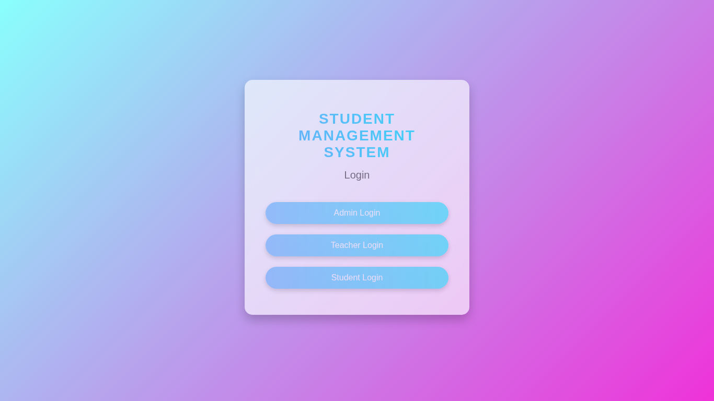

### 2. Admin Login
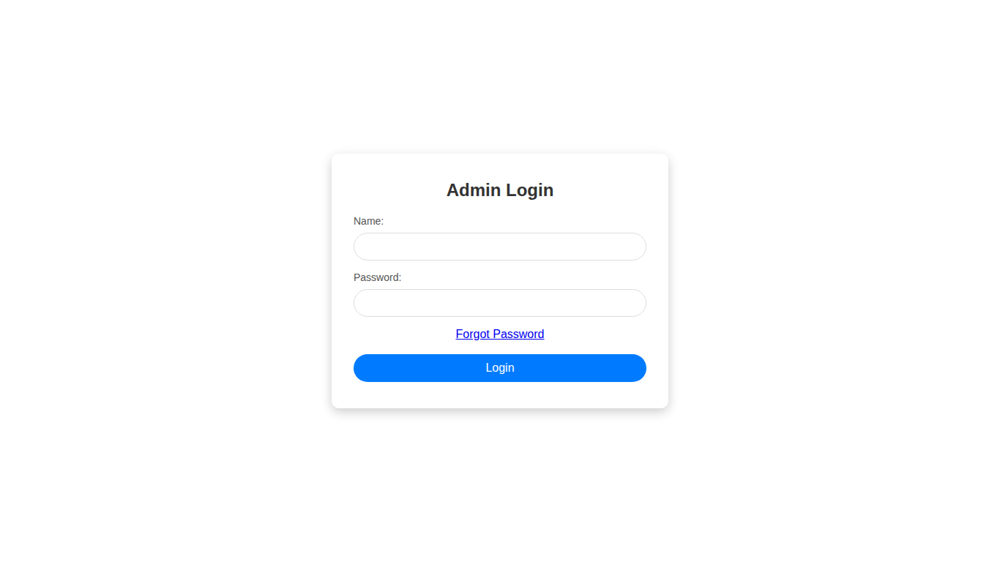

### 3. Teacher Login
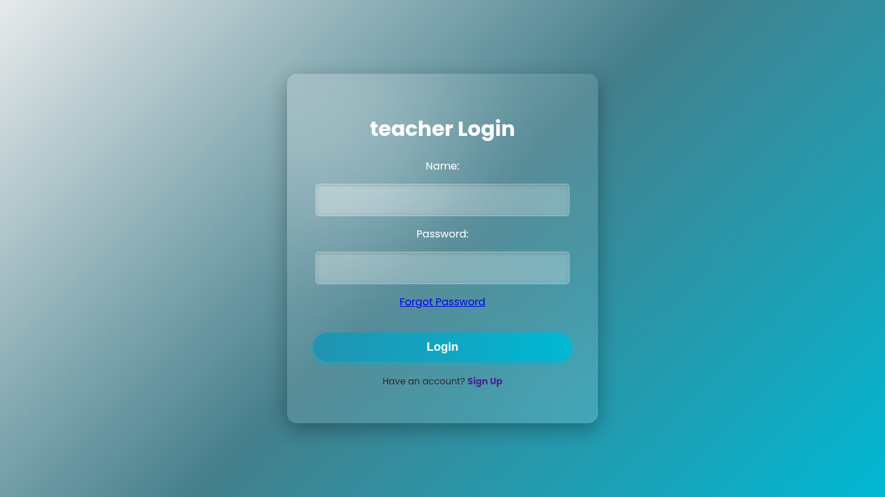

### 4. Student Login
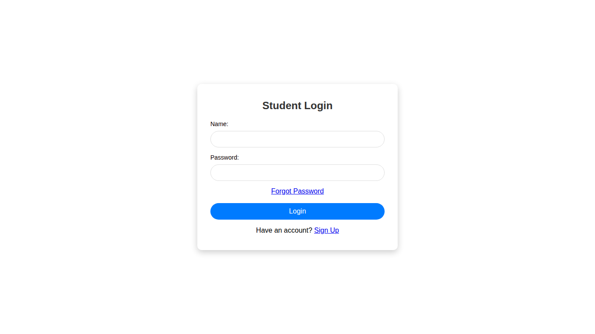

### 5. Sign Up
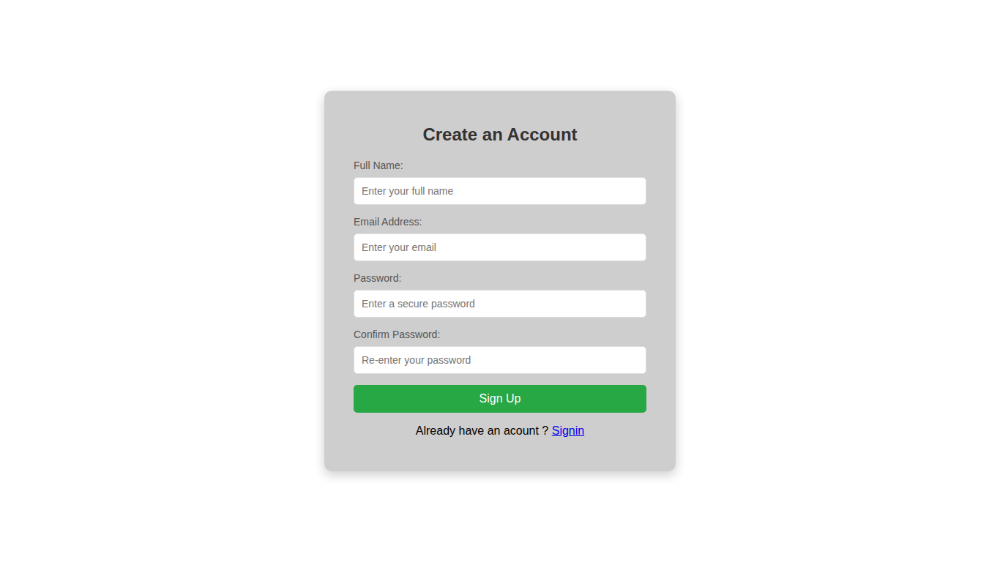

### 6. Forgot Password (OTP Verification)
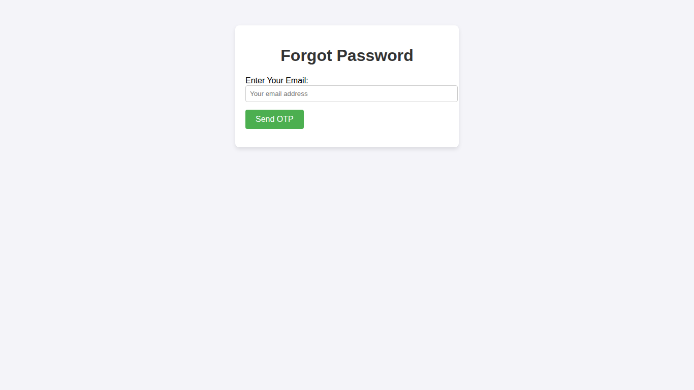

### 7. Admin Dashboard
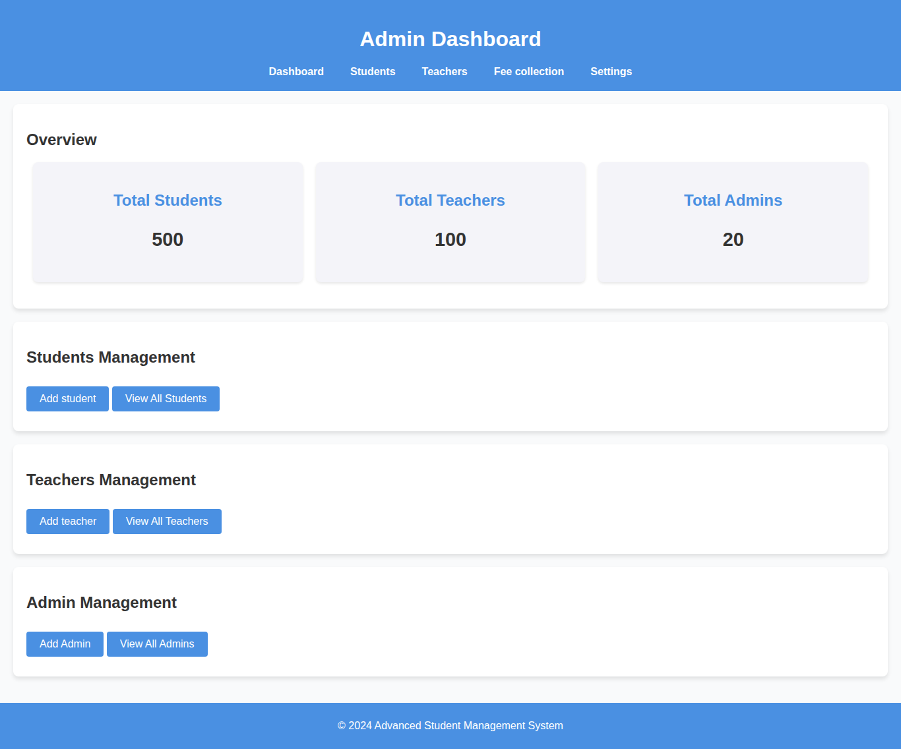

### 8. Student Database
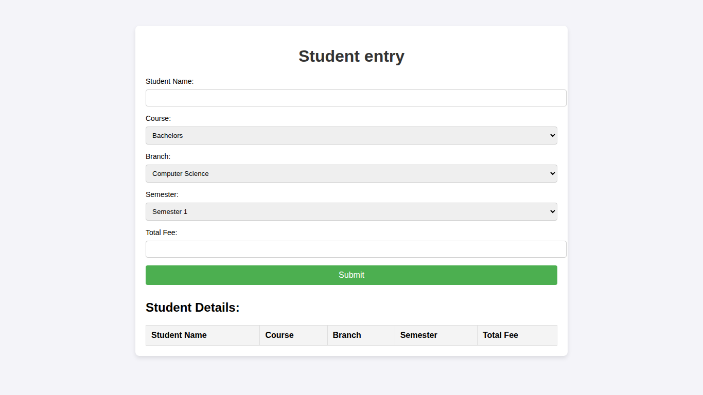

### 9. Teacher Database
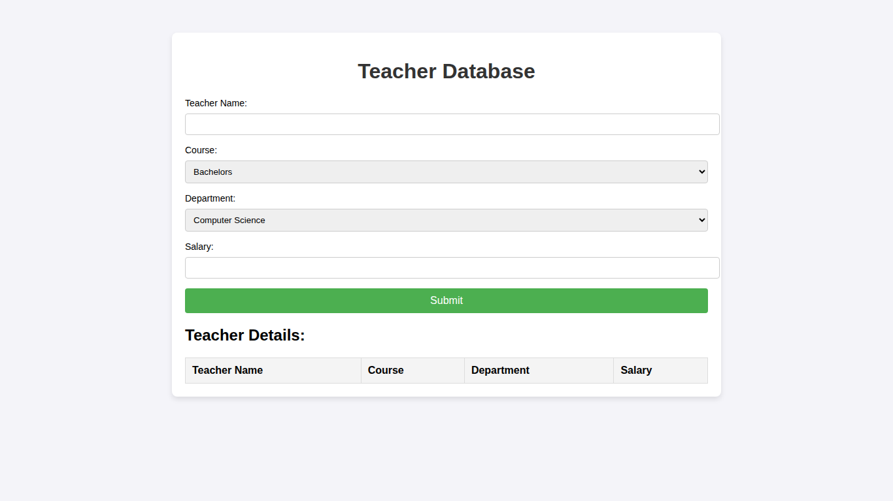

### 10. Fee Collection
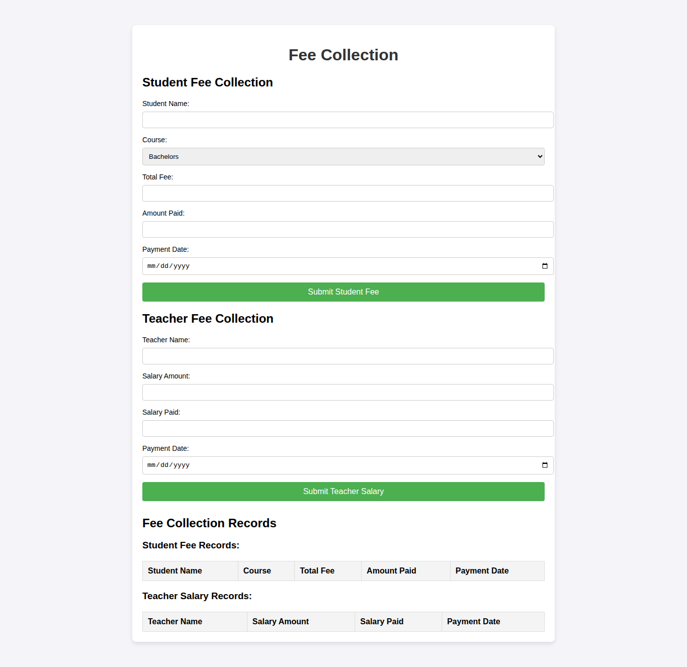

### 11. Settings
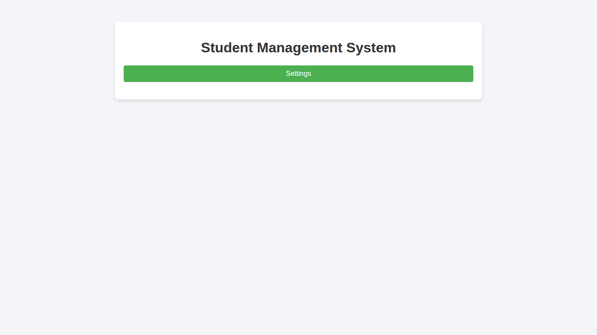

### 12. Student Dashboard
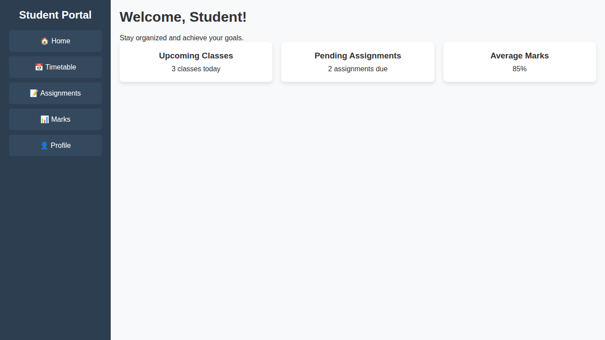

### 13. Teacher Dashboard
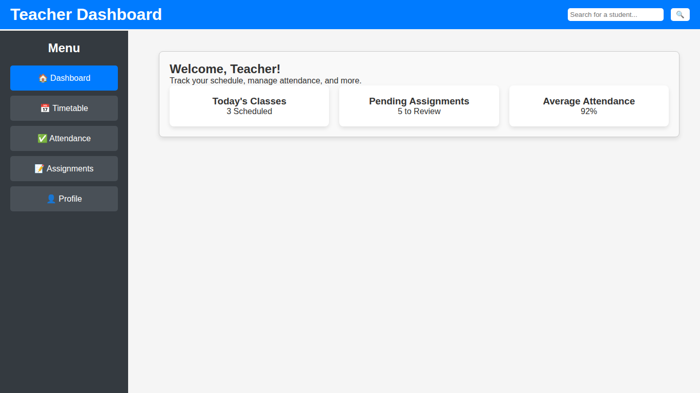

## 🔮 Future Improvements

- Attendance tracking
- Exam results and report cards
- Role-based access control with secure sessions
- Password hashing and input validation
- Export reports to PDF / Excel

## 🤝 Contributing

1. Fork the repository
2. Create a feature branch (`git checkout -b feature/your-feature`)
3. Commit your changes (`git commit -m "Add your feature"`)
4. Push to the branch (`git push origin feature/your-feature`)
5. Open a Pull Request

## 👤 Author

**San097**
GitHub: [@San097](https://github.com/San097)
